## Technical Skills

### Languages & Frameworks

  

### Cloud Computing

#### Microsoft Azure

  
  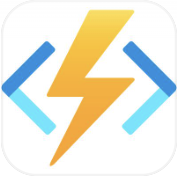
  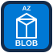
  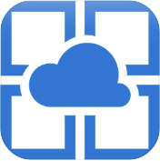

`Azure Functions` `Blob Storage` `App Service`

#### Amazon Web Services

  
  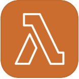
  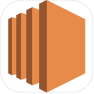
  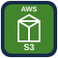
  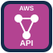
  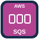
  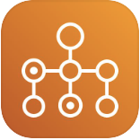

`Lambda` `EC2` `S3` `API Gateway` `SQS` `Batch`

### Databases

  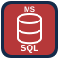
  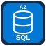
  
  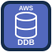

`SQL Server` `Azure SQL Database` `MySQL` `DynamoDB`

### DevOps & Development Tools

  
  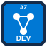

### Software Architecture & Engineering

### Artificial Intelligence

  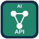

`OpenAI API` `LLM Integration` `AI-powered Applications`

---

## Currently Learning

  
  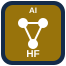
  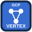
  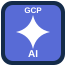

`Google Cloud` `Python` `Generative AI` `AI Agents`
`RAG` `Vertex AI` `Application Modernization`

---
