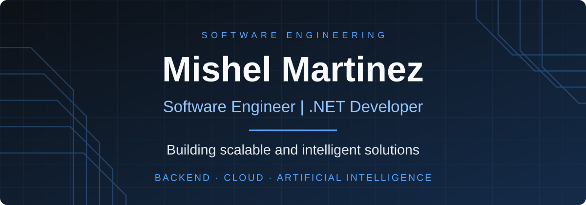

  

<h3 align="center">
  From Backend Engineering to Cloud & AI
</h3>

  

  
  
  

---

## About Me

I'm a Software Engineer from Mexico with over 6 years of experience developing enterprise applications, backend services and scalable software solutions.

- 💻 Specialized in C#, .NET and backend engineering.
- 🏗️ Experienced in microservices, DDD and CQRS.
- ☁️ Building solutions with cloud technologies.
- 🤖 Currently expanding my expertise in Cloud & AI Engineering.
- 🎯 Passionate about application modernization and intelligent enterprise solutions.

---
